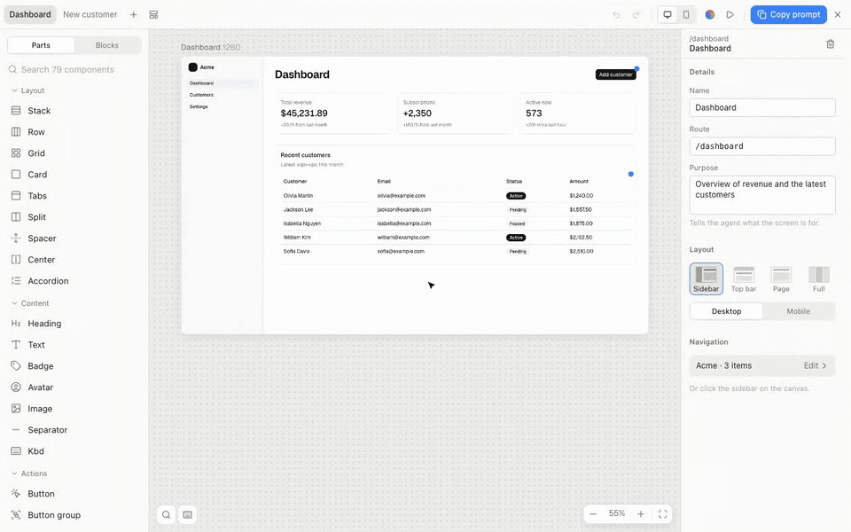

<picture>
  <source media="(prefers-color-scheme: dark)" srcset="logo-dark.svg">
  
</picture>

<br>

**sketchcn** is a sketch tool for shadcn/ui. Drag your own components onto a screen, link screens into a flow, and copy a brief your coding agent can build without guessing.



## Install

```bash
npx shadcn@latest add https://vittoriotaucer.github.io/r/sketchcn.json
```

It lands in `components/sketchcn/` like any other shadcn component, along with the ui components it uses.

## Usage

```tsx
import { Sketch } from "@/components/sketchcn"

function App() {
  return (
    <>
      <YourApp />
      {import.meta.env.DEV && <Sketch />}
    </>
  )
}
```

Press <kbd>S</kbd> to open the canvas. Sketch, press <kbd>C</kbd>, and paste the prompt into Claude Code, Codex, Cursor or any agent.

## Features

- **Your components** – 79 parts rendered with the components in your project and your theme
- **Blocks** – 67 designed sections: headers, sidebars, composers, chat layouts, chart panels, an API console and more
- **Presets** – 16 linked multi-screen starting points, desktop and mobile
- **AI parts** – Messages, reasoning, tool calls, diffs, approvals, terminals, task queues and composers
- **Flows** – Link any element to a screen, then press <kbd>P</kbd> to click through
- **Intent notes** – Tell the agent what an element does; it lands in the prompt as a comment
- **Themes** – Base color, accent, radius and font, live on the sketch and handed to the agent
- **Infinite canvas** – Pan and zoom like a design tool, at real device widths
- **Keyboard first** – <kbd>⌘K</kbd> for everything, Figma's alignment keys, undo everywhere
- **Agent-agnostic** – Copy a prompt, or the raw sketch as JSON

## Blocks and presets

shadcn gives you the atoms. A full app template gives you someone else's product. Blocks are the middle: the sections AI-native products are assembled from, each in several variants.

| Group | Variants |
|-------|----------|
| Headers | page, app bar, tabs, toolbar, chat thread, settings close, section |
| Sidebars | console, agent threads, chat history, workspace, settings nav, icon rail |
| Composers | box with modes and branch, pill with model line, agent with context, attachments, suggestions, slash menu |
| Chat layouts | reading column, right panel, bottom drawer, transcript, compact panel, artifact split |
| Agent steps | plan and act, approvals, inline review, diff review, terminal run, answer with sources |
| Data | metrics, chart panels, tables, API console, billing |
| More | account menus, settings sections, empty states |

Sidebars are treated as layout: dropping one wraps the screen into sidebar and content, or swaps the one that's there. Hover any block for a full-size preview.

Presets are complete flows (dashboard, mail, tasks, settings, auth, database studio, issue tracker, booking page, CRM, AI chat, agent builder, coding agent, agent panel, AI teammates) whose layouts were studied from open-source apps. See [Credits](#credits).

## Props

| Prop | Type | Default | Description |
|------|------|---------|-------------|
| `defaultOpen` | `boolean` | `false` | Open the canvas on first render |
| `hotkey` | `string` | `"s"` | Key that toggles the canvas |
| `uiAlias` | `string` | `"@/components/ui"` | Import path written into the prompt |
| `onCopy` | `(prompt: string) => void` | - | Called with the prompt each time it is copied |

## Shortcuts

| Key | Action |
|-----|--------|
| <kbd>S</kbd> | Open or close |
| <kbd>⌘K</kbd> | Search parts, blocks, screens and actions |
| <kbd>T</kbd> | Presets |
| <kbd>P</kbd> | Preview the flow |
| <kbd>C</kbd> | Copy prompt |
| <kbd>1</kbd>–<kbd>9</kbd> | Switch screen |
| <kbd>↑</kbd> <kbd>↓</kbd> · <kbd>⇧↑</kbd> <kbd>⇧↓</kbd> | Select · move |
| <kbd>⌘D</kbd> · <kbd>⌫</kbd> | Duplicate · delete |
| <kbd>⌥A</kbd> <kbd>⌥H</kbd> <kbd>⌥D</kbd> | Align left, center, right |
| <kbd>⇧1</kbd> · <kbd>⇧0</kbd> | Zoom to fit · 100% |
| <kbd>⌘Z</kbd> · <kbd>⇧⌘Z</kbd> | Undo · redo |
| <kbd>Esc</kbd> | Step back: parent, preview, close |
| <kbd>?</kbd> | All shortcuts |

## How it works

- **A tree, not a picture** — every part renders with your components and describes itself as JSX
- **Your imports** — the prompt lists only the components the sketch uses, at your alias
- **The flow** — links between screens become routes and navigation in the brief
- **Intent** — notes and screen purposes become comments the agent follows
- **Theme** — overrides become a `globals.css` block and a font install line
- **Local** — the sketch lives in your browser; nothing leaves your machine until you copy it

No runtime dependencies beyond React, lucide-react and your shadcn components.

## Requirements

- React 18+
- shadcn/ui with Tailwind CSS v4
- Desktop browser

## Develop

```bash
pnpm install
pnpm dev
pnpm registry:build   # writes public/r/sketchcn.json
```

## Credits

Presets recreate the layout and interaction patterns of open-source apps with sketchcn parts. No code, assets or branding are copied.

| Preset | Layout studied from |
|--------|---------------------|
| Admin Dashboard, Mail Client, Task Tracker, Settings Pages, Auth Flow | shadcn-ui/ui (MIT) |
| Database studio | supabase/supabase (Apache-2.0) |
| Issue tracker | makeplane/plane (AGPL-3.0) |
| Booking page | calcom/cal.com (AGPL-3.0) |
| CRM | twentyhq/twenty (AGPL-3.0) |
| AI chat | vercel/chatbot (Apache-2.0), open-webui/open-webui (BSD-3-Clause), danny-avila/LibreChat (MIT) |
| Agent builder | danny-avila/LibreChat (MIT), open-webui/open-webui (BSD-3-Clause) |
| Coding agent | OpenHands/OpenHands (MIT), openai/codex (Apache-2.0) |
| Agent panel | cline/cline (Apache-2.0), openai/codex (Apache-2.0) |
| AI teammates, AI teammates mobile | elie222/rakazo (Apache-2.0) |

## License

© 2026 [vittoriomta](https://vittoriotaucer.github.io)

Licensed under MIT
